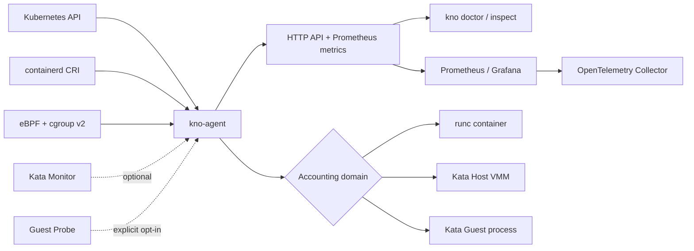

# KubeNode-Observer

[](https://github.com/cowhorse05/KubeNode-Observer/actions/workflows/ci.yml)
[](LICENSE)

**Runtime-aware Kubernetes diagnostics with first-class runc and Kata isolation visibility.**

KubeNode-Observer (KNO) is a Linux node agent and CLI for answering one operational question:

> Is a slow Kubernetes Pod blocked in a normal container, inside a Kata Guest, or in the Host-side VMM that runs it?

KNO combines eBPF scheduler data with Kubernetes, CRI and cgroup v2 identity. It keeps runc containers, Kata sandboxes, Host VMM processes and optional Guest processes in explicit accounting domains instead of presenting missing or cross-boundary data as zero.

## Why KNO

Existing projects already solve important adjacent problems: node exporters expose machine metrics, Tetragon and Inspektor Gadget observe kernel events, and Parca/Pyroscope provide continuous profiling. KNO does not replace those systems. It supplies the runtime-isolation context needed to diagnose runc and Kata workloads and is designed to feed standard observability stacks.

The primary workflow is intentionally small:

```bash
kno doctor
kno inspect pod <pod> -n <namespace>
```

- `kno doctor` checks Agent reachability, eBPF state, map census, lifecycle loss, CRI topology, cgroup attribution, Kubernetes identity, current Kata identity and node-read permissions.
- `kno inspect pod` combines topology, Host resources, CPU hotspots, run queue latency, recent process lifecycle events and optional Guest evidence into one bounded report.

Both commands provide versioned JSON for automation. Partial, unavailable and lost evidence remains explicit.

## Architecture



KNO uses high-frequency eBPF aggregation in the kernel and bounded user-space snapshots. A Kata VMM is not inserted into the normal container process index, and VMM RSS or IO is never labeled as Guest resource usage.

## Capabilities

- CO-RE eBPF lifecycle, CPU runtime and run queue latency collection;
- Node → Pod → Container → Process attribution through Kubernetes, CRI and cgroup v2;
- runc container and Kata Sandbox/VMM Host resource views;
- optional Kata Guest CPU/runqlat collection with verified Sandbox identity;
- explicit Host/Guest domains, partial-data warnings and lifecycle loss counters;
- read-only `doctor` and `inspect pod` operational workflows;
- Prometheus exposition and optional Prometheus Operator `ServiceMonitor`;
- repeatable runc/Kata acceptance evidence with `make m11-acceptance`.

KNO does **not** provide a storage backend, Web UI, generic continuous profiler, runtime security policy engine or automatic remediation. Use it alongside Prometheus/Grafana and an existing profiler such as Parca or Pyroscope.

## Quick start

### Requirements

- Linux x86_64 with BTF and cgroup v2;
- Kubernetes 1.25 or newer;
- containerd with CRI v1;
- Helm 3 or 4;
- privileged DaemonSets and the documented host mounts.

Kata and the Guest Probe are optional. A standard runc cluster is enough for the default deployment.

### Build a development image

```bash
make build
make image-local IMAGE=kubenode-observer/kno-agent:dev
```

Load the image into the target development cluster, for example:

```bash
minikube -p kno-dev image load --overwrite=true kubenode-observer/kno-agent:dev
# or: kind load docker-image kubenode-observer/kno-agent:dev --name <cluster>
```

### Install with Helm

```bash
helm install kno ./charts/kubenode-observer \
  --namespace kno-system \
  --create-namespace \
  --set image.repository=kubenode-observer/kno-agent \
  --set image.tag=dev
```

The chart defaults to the continuously published GHCR `main` image. Override it as shown above for local development, and pin a version tag for reproducible environments once a release is published.

Check the deployment and open a local API tunnel:

```bash
kubectl -n kno-system rollout status daemonset/kno-kubenode-observer
kubectl -n kno-system port-forward service/kno-kubenode-observer 18080:18080
```

Run the operator workflow from another terminal:

```bash
./bin/kno doctor
./bin/kno inspect pod <pod> -n <namespace>
./bin/kno inspect pod <pod> -n <namespace> -o json
```

See the [Helm chart README](charts/kubenode-observer/README.md), [doctor contract](docs/doctor.md), [inspect contract](docs/inspect-pod.md) and [final acceptance workflow](docs/m11-acceptance.md).

## Prometheus integration

The Agent exposes `/metrics` on port `18080`. Pod scrape annotations are enabled by default. If Prometheus Operator is installed, enable its native discovery resource:

```bash
helm upgrade --install kno ./charts/kubenode-observer \
  --namespace kno-system \
  --create-namespace \
  --set serviceMonitor.enabled=true
```

The endpoint describes Agent health, resource cost, BPF map state, event loss, runtime-boundary inventory and background runc CPU usage. The Chart can also install a practical `PrometheusRule` and Grafana dashboard ConfigMap:

```bash
helm upgrade --install kno ./charts/kubenode-observer \
  --namespace kno-system --create-namespace \
  --set serviceMonitor.enabled=true \
  --set prometheusRule.enabled=true \
  --set grafanaDashboard.enabled=true
```

For OTLP, use the documented OpenTelemetry Collector Prometheus receiver pipeline instead of adding another exporter to KNO. See [metrics and ecosystem integration](docs/metrics.md).

## Kata and Guest boundaries

Kata Host/VMM discovery requires an installed Kata RuntimeClass and host-visible Kata processes. The official Kata Monitor is optional and configured with `agent.kataMonitorEndpoint`.

Guest collection is disabled by default. Enabling it requires a dedicated RuntimeClass, an explicitly configured Guest Probe and relay, shared Pod PID namespace, and the security boundary documented in the [Guest Probe guide](docs/guest-probe.md). Without Guest evidence, KNO reports the Host VMM view and a warning; it does not infer Guest usage.

## Development

```bash
go test ./...
python3 -m unittest discover -s hack -p '*_test.py'
make build
make helm-lint
```

Run the Helm API smoke test against the current Kubernetes context:

```bash
make helm-smoke
```

Live eBPF integration tests require a compatible Linux node. See [CONTRIBUTING.md](CONTRIBUTING.md), the [support matrix](docs/support-matrix.md) and the [architecture notes](docs/architecture.md).

## Project status

The runc collection path and the Kata Host/VMM/Guest prototype are implemented. The project is now moving from a research-oriented repository toward an installable diagnostic component:

1. Helm packaging, repository hygiene and open-source governance;
2. bounded workload/VMM Prometheus metrics and Grafana dashboards;
3. OpenTelemetry Collector and profiler correlation examples;
4. release images, SBOMs, signing and a documented compatibility matrix;
5. an upstream-oriented Kata Guest observability design proposal.

The detailed sequence and non-goals are tracked in the [product roadmap](docs/product-roadmap.md).

Historical experiments remain available as curated Markdown reports under [`log/`](log/). Raw captures are intentionally excluded from the main tree and should be attached to releases or pull requests.

## Security

The current Agent is privileged and reads sensitive node interfaces including procfs, cgroup v2, tracefs and the containerd socket. Do not expose its HTTP API outside the intended cluster/network boundary. Read [SECURITY.md](SECURITY.md) before production evaluation.

## License

Apache License 2.0. See [LICENSE](LICENSE).
